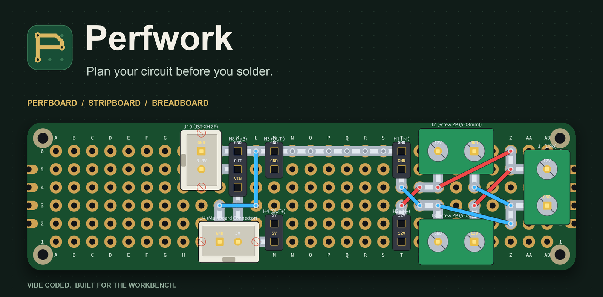

<p align="center">
  
</p>

A visual layout editor for **perfboards, stripboards, and breadboards**. Place components, route wires, and flip the board to work on the solder side—all in one workspace.

Built in Rust with [egui](https://github.com/emilk/egui). Runs on desktop (macOS, Linux, Windows) and in the browser via WebAssembly.

> **Vibe coded, work in progress.** Built with AI assistance. Expect rough edges, and double-check layouts and dimensions before building hardware.

## What you can do

- **Lay out multiple boards** with custom sizes, labels, colors, and common perfboard presets.
- **Place through-hole parts** including headers, JST connectors, screw terminals, DIP sockets, resistors, and switches.
- **Route wires and solder bridges**, with straight or curved wires, alignment snapping, and stripboard track cuts.
- **See both sides** with a mirrored solder-side view and transparent component housings.
- **Save and share** projects as JSON. Export front/back PNGs and simplified 3D STEP models for enclosure planning on desktop.

## Run it

From a checkout of this repository:

**With Nix** (flakes enabled):

```sh
nix run
```

**With Rust** (stable toolchain and your platform's native build dependencies):

```sh
cargo run --release
```

**In a local browser** (requires [Trunk](https://trunkrs.dev/) and Rust):

```sh
rustup target add wasm32-unknown-unknown
trunk serve --open
```

## Your first layout

1. Press **A** to add a board, then open the same dialog to place components. Or try **File → Load Demo Circuit**.
2. Use **W** for wires and **S** for solder bridges. Press **Tab** while routing to switch between straight and curved wires.
3. Select items and press **M** to move them. **Esc** cancels the current operation.
4. Press **F** to flip to the solder side; **G** toggles transparent housings.
5. Save with **File → Save Project…** on desktop, or use **File → Import / Export JSON…** to copy your layout in the browser.

Choose **Touchpad** or **Mouse** controls in the bottom-right status bar. Touchpad scrolling pans; the mouse wheel zooms.

## Development

```sh
nix develop
cargo test
cargo clippy --all-targets -- -D warnings
```

Additional export checks: [STEP validation](tools/validate_step.sh) (requires FreeCAD) and [PNG validation](tools/validate_png.sh) (opens a GPU-backed window). STEP exports use simplified component bodies with nominal heights—check dimensions against your actual parts.
